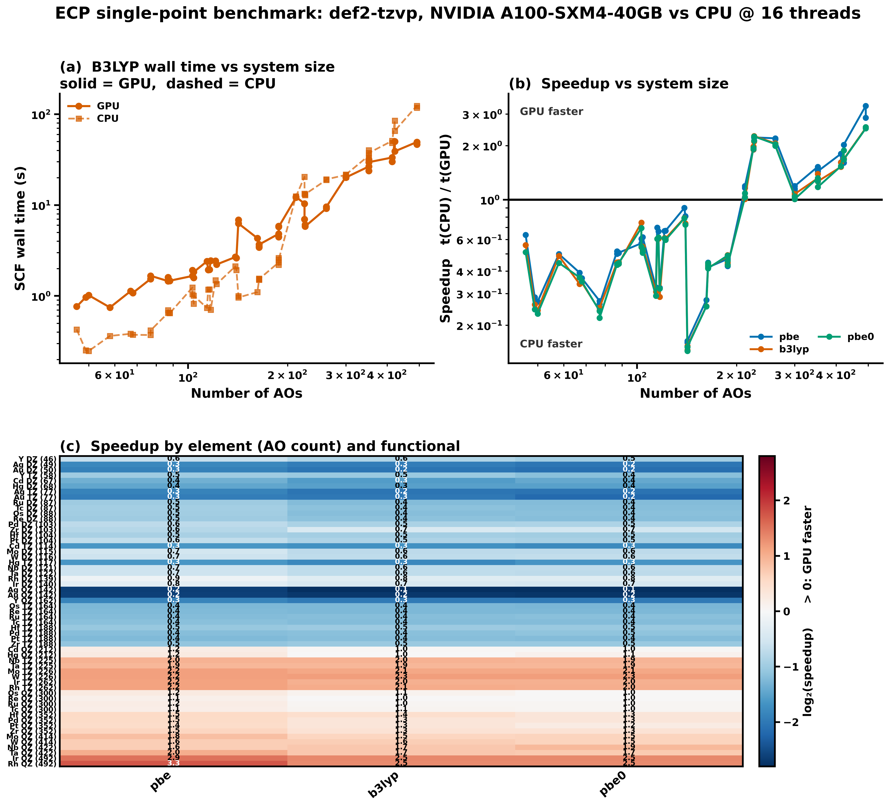

# ECP single-point benchmark: GPU4PySCF vs PySCF

19 closed-shell transition-metal complexes, each carrying a def2-ECP, run at 3 bases (DZ, TZ, QZ) with 3 functionals on both devices. No 5Z rung: gpu4pyscf's ECP kernels stop at g functions (see `systems_tm.py`).

> [!NOTE]
> Geometries are idealized VSEPR shapes with tabulated bond lengths, not optimized. Both devices see identical coordinates, so GPU/CPU comparisons are exact; the absolute energies are not thermochemical reference values.

## Settings

| key | value |
|---|---|
| systems | `tm` |
| method | `auto` |
| basis | `def2-tzvp` |
| grid | `[75, 302]` |
| conv_tol | `1e-09` |
| max_cycle | `100` |
| density_fit | `False` |
| conv_aids | `True` |
| cpu_threads | `16` |
| repeat | `1` |
| gpu | `NVIDIA A100-SXM4-40GB` |
| contract_engine | `cutensor` |
| cupy | `14.2.0` |
| pyscf | `2.13.0` |
| gpu4pyscf | `1.8.1` |
| git_commit | `b2972fc77` |
| hostname | `nid002457` |
| slurm_job_id | `59382195` |
| timestamp | `2026-10-06T03:08:34-0700` |
| functionals | `pbe b3lyp pbe0` |

CPU references are built fresh from the Mole (`pyscf.dft.RKS` / `pyscf.dft.UKS`), never via `to_cpu()` of a converged GPU object -- that inherits the GPU density and biases CPU timings low by ~6x. The restricted/unrestricted choice depends only on the molecule and the `--method` flag, so both devices always run the same flavour.

## Failures

None: every run converged on both devices.

## GPU vs CPU energy agreement

Worst |E_GPU - E_CPU| across functionals, per system. Threshold 1e-08 Ha.

| system | compound | chg | 2S | SCF | natm | nao | max abs dE (Ha) | worst functional | status |
|---|---|---:|---:|---|---:|---:|---:|---|---|
| Y DZ | YH3 | +0 | 0 | RKS | 4 | 46 | 2.49e-12 | pbe0 | ok |
| Zr DZ | ZrCl4 | +0 | 0 | RKS | 5 | 103 | 3.68e-11 | pbe | ok |
| Nb DZ | NbCl5 | +0 | 0 | RKS | 6 | 121 | 8.59e-11 | pbe0 | ok |
| Mo DZ | MoF6 | +0 | 0 | RKS | 7 | 115 | 5.07e-11 | pbe | ok |
| Tc DZ | TcO4- | -1 | 0 | RKS | 5 | 87 | 5.89e-11 | b3lyp | ok |
| Ru DZ | RuO4 | +0 | 0 | RKS | 5 | 87 | 2.90e-10 | pbe0 | ok |
| Rh DZ | RhCl6_3- | -3 | 0 | RKS | 7 | 139 | 1.52e-10 | pbe0 | ok |
| Pd DZ | PdCl4_2- | -2 | 0 | RKS | 5 | 103 | 1.22e-10 | b3lyp | ok |
| Ag DZ | AgCl | +0 | 0 | RKS | 2 | 49 | 2.00e-11 | pbe0 | ok |
| Cd DZ | CdCl2 | +0 | 0 | RKS | 3 | 67 | 7.09e-11 | pbe | ok |
| Hf DZ | HfCl4 | +0 | 0 | RKS | 5 | 104 | 1.03e-10 | pbe | ok |
| Ta DZ | TaCl5 | +0 | 0 | RKS | 6 | 122 | 3.83e-10 | pbe | ok |
| W DZ | WF6 | +0 | 0 | RKS | 7 | 116 | 3.91e-11 | pbe | ok |
| Re DZ | ReO4- | -1 | 0 | RKS | 5 | 88 | 7.16e-11 | b3lyp | ok |
| Os DZ | OsO4 | +0 | 0 | RKS | 5 | 88 | 1.48e-10 | pbe | ok |
| Ir DZ | IrCl6_3- | -3 | 0 | RKS | 7 | 140 | 1.04e-10 | pbe0 | ok |
| Pt DZ | PtCl4_2- | -2 | 0 | RKS | 5 | 104 | 9.28e-11 | pbe0 | ok |
| Au DZ | AuCl | +0 | 0 | RKS | 2 | 50 | 1.38e-11 | pbe0 | ok |
| Hg DZ | HgCl2 | +0 | 0 | RKS | 3 | 68 | 2.98e-11 | pbe0 | ok |
| Y TZ | YH3 | +0 | 0 | RKS | 4 | 58 | 6.42e-12 | b3lyp | ok |
| Zr TZ | ZrCl4 | +0 | 0 | RKS | 5 | 188 | 1.56e-10 | pbe0 | ok |
| Nb TZ | NbCl5 | +0 | 0 | RKS | 6 | 225 | 7.32e-11 | b3lyp | ok |
| Mo TZ | MoF6 | +0 | 0 | RKS | 7 | 226 | 5.21e-11 | b3lyp | ok |
| Tc TZ | TcO4- | -1 | 0 | RKS | 5 | 164 | 1.70e-10 | pbe | ok |
| Ru TZ | RuO4 | +0 | 0 | RKS | 5 | 164 | 6.58e-11 | b3lyp | ok |
| Rh TZ | RhCl6_3- | -3 | 0 | RKS | 7 | 262 | 3.63e-10 | pbe | ok |
| Pd TZ | PdCl4_2- | -2 | 0 | RKS | 5 | 188 | 1.07e-10 | pbe | ok |
| Ag TZ | AgCl | +0 | 0 | RKS | 2 | 77 | 1.89e-11 | pbe | ok |
| Cd TZ | CdCl2 | +0 | 0 | RKS | 3 | 114 | 4.07e-11 | b3lyp | ok |
| Hf TZ | HfCl4 | +0 | 0 | RKS | 5 | 188 | 3.06e-10 | pbe0 | ok |
| Ta TZ | TaCl5 | +0 | 0 | RKS | 6 | 225 | 1.28e-10 | pbe0 | ok |
| W TZ | WF6 | +0 | 0 | RKS | 7 | 226 | 8.75e-11 | pbe | ok |
| Re TZ | ReO4- | -1 | 0 | RKS | 5 | 164 | 1.07e-10 | pbe | ok |
| Os TZ | OsO4 | +0 | 0 | RKS | 5 | 164 | 1.21e-10 | pbe | ok |
| Ir TZ | IrCl6_3- | -3 | 0 | RKS | 7 | 262 | 4.06e-10 | b3lyp | ok |
| Pt TZ | PtCl4_2- | -2 | 0 | RKS | 5 | 188 | 8.50e-11 | b3lyp | ok |
| Au TZ | AuCl | +0 | 0 | RKS | 2 | 77 | 1.58e-11 | pbe0 | ok |
| Hg TZ | HgCl2 | +0 | 0 | RKS | 3 | 117 | 3.37e-11 | pbe0 | ok |
| Y QZ | YH3 | +0 | 0 | RKS | 4 | 162 | 4.18e-12 | b3lyp | ok |
| Zr QZ | ZrCl4 | +0 | 0 | RKS | 5 | 352 | 5.88e-10 | pbe0 | ok |
| Nb QZ | NbCl5 | +0 | 0 | RKS | 6 | 422 | 2.48e-10 | pbe | ok |
| Mo QZ | MoF6 | +0 | 0 | RKS | 7 | 414 | 1.00e-10 | b3lyp | ok |
| Tc QZ | TcO4- | -1 | 0 | RKS | 5 | 300 | 2.93e-10 | pbe | ok |
| Ru QZ | RuO4 | +0 | 0 | RKS | 5 | 300 | 3.90e-10 | pbe | ok |
| Rh QZ | RhCl6_3- | -3 | 0 | RKS | 7 | 492 | 2.38e-09 | pbe | ok |
| Pd QZ | PdCl4_2- | -2 | 0 | RKS | 5 | 352 | 4.27e-10 | pbe | ok |
| Ag QZ | AgCl | +0 | 0 | RKS | 2 | 142 | 2.92e-11 | pbe0 | ok |
| Cd QZ | CdCl2 | +0 | 0 | RKS | 3 | 212 | 1.89e-10 | b3lyp | ok |
| Hf QZ | HfCl4 | +0 | 0 | RKS | 5 | 352 | 9.40e-10 | pbe0 | ok |
| Ta QZ | TaCl5 | +0 | 0 | RKS | 6 | 422 | 2.72e-10 | pbe | ok |
| W QZ | WF6 | +0 | 0 | RKS | 7 | 414 | 7.84e-11 | pbe0 | ok |
| Re QZ | ReO4- | -1 | 0 | RKS | 5 | 300 | 2.14e-10 | b3lyp | ok |
| Os QZ | OsO4 | +0 | 0 | RKS | 5 | 300 | 1.72e-10 | pbe0 | ok |
| Ir QZ | IrCl6_3- | -3 | 0 | RKS | 7 | 492 | 5.98e-10 | pbe | ok |
| Pt QZ | PtCl4_2- | -2 | 0 | RKS | 5 | 352 | 2.31e-10 | pbe0 | ok |
| Au QZ | AuCl | +0 | 0 | RKS | 2 | 142 | 2.52e-11 | pbe | ok |
| Hg QZ | HgCl2 | +0 | 0 | RKS | 3 | 212 | 5.02e-11 | pbe0 | ok |

## Speedup (CPU wall time / GPU wall time)

CPU at 16 threads, single GPU. Values below 1.00 mean the CPU was faster.

| system | compound | nao | pbe | b3lyp | pbe0 | mean |
|---|---|---:|---:|---:|---:|---:|
| Y DZ | YH3 | 46 | 0.64 | 0.56 | 0.51 | 0.57 |
| Zr DZ | ZrCl4 | 103 | 0.57 | 0.74 | 0.70 | 0.67 |
| Nb DZ | NbCl5 | 121 | 0.67 | 0.61 | 0.61 | 0.63 |
| Mo DZ | MoF6 | 115 | 0.70 | 0.61 | 0.60 | 0.64 |
| Tc DZ | TcO4- | 87 | 0.52 | 0.45 | 0.44 | 0.47 |
| Ru DZ | RuO4 | 87 | 0.50 | 0.43 | 0.43 | 0.46 |
| Rh DZ | RhCl6_3- | 139 | 0.90 | 0.79 | 0.79 | 0.83 |
| Pd DZ | PdCl4_2- | 103 | 0.61 | 0.54 | 0.55 | 0.57 |
| Ag DZ | AgCl | 49 | 0.29 | 0.26 | 0.24 | 0.26 |
| Cd DZ | CdCl2 | 67 | 0.39 | 0.34 | 0.37 | 0.37 |
| Hf DZ | HfCl4 | 104 | 0.54 | 0.52 | 0.51 | 0.52 |
| Ta DZ | TaCl5 | 122 | 0.67 | 0.61 | 0.60 | 0.63 |
| W DZ | WF6 | 116 | 0.67 | 0.61 | 0.62 | 0.63 |
| Re DZ | ReO4- | 88 | 0.50 | 0.45 | 0.44 | 0.46 |
| Os DZ | OsO4 | 88 | 0.51 | 0.44 | 0.44 | 0.46 |
| Ir DZ | IrCl6_3- | 140 | 0.81 | 0.74 | 0.73 | 0.76 |
| Pt DZ | PtCl4_2- | 104 | 0.62 | 0.55 | 0.53 | 0.56 |
| Au DZ | AuCl | 50 | 0.27 | 0.24 | 0.23 | 0.25 |
| Hg DZ | HgCl2 | 68 | 0.37 | 0.35 | 0.35 | 0.35 |
| Y TZ | YH3 | 58 | 0.50 | 0.49 | 0.44 | 0.48 |
| Zr TZ | ZrCl4 | 188 | 0.47 | 0.48 | 0.49 | 0.48 |
| Nb TZ | NbCl5 | 225 | 1.97 | 1.98 | 1.94 | 1.96 |
| Mo TZ | MoF6 | 226 | 2.22 | 2.11 | 2.13 | 2.15 |
| Tc TZ | TcO4- | 164 | 0.45 | 0.43 | 0.43 | 0.44 |
| Ru TZ | RuO4 | 164 | 0.43 | 0.44 | 0.44 | 0.44 |
| Rh TZ | RhCl6_3- | 262 | 2.20 | 2.06 | 2.04 | 2.10 |
| Pd TZ | PdCl4_2- | 188 | 0.44 | 0.45 | 0.46 | 0.45 |
| Ag TZ | AgCl | 77 | 0.27 | 0.24 | 0.24 | 0.25 |
| Cd TZ | CdCl2 | 114 | 0.33 | 0.31 | 0.29 | 0.31 |
| Hf TZ | HfCl4 | 188 | 0.48 | 0.49 | 0.49 | 0.48 |
| Ta TZ | TaCl5 | 225 | 1.90 | 1.91 | 1.92 | 1.91 |
| W TZ | WF6 | 226 | 2.22 | 2.26 | 2.25 | 2.24 |
| Re TZ | ReO4- | 164 | 0.43 | 0.42 | 0.42 | 0.42 |
| Os TZ | OsO4 | 164 | 0.42 | 0.42 | 0.41 | 0.42 |
| Ir TZ | IrCl6_3- | 262 | 2.17 | 2.01 | 2.00 | 2.06 |
| Pt TZ | PtCl4_2- | 188 | 0.43 | 0.44 | 0.43 | 0.43 |
| Au TZ | AuCl | 77 | 0.26 | 0.25 | 0.22 | 0.24 |
| Hg TZ | HgCl2 | 117 | 0.32 | 0.29 | 0.32 | 0.31 |
| Y QZ | YH3 | 162 | 0.28 | 0.25 | 0.25 | 0.26 |
| Zr QZ | ZrCl4 | 352 | 1.52 | 1.32 | 1.32 | 1.39 |
| Nb QZ | NbCl5 | 422 | 1.61 | 1.69 | 1.88 | 1.73 |
| Mo QZ | MoF6 | 414 | 1.80 | 1.52 | 1.54 | 1.62 |
| Tc QZ | TcO4- | 300 | 1.14 | 1.05 | 1.04 | 1.08 |
| Ru QZ | RuO4 | 300 | 1.15 | 1.04 | 1.04 | 1.08 |
| Rh QZ | RhCl6_3- | 492 | 3.33 | 2.51 | 2.49 | 2.78 |
| Pd QZ | PdCl4_2- | 352 | 1.46 | 1.27 | 1.27 | 1.33 |
| Ag QZ | AgCl | 142 | 0.16 | 0.15 | 0.14 | 0.15 |
| Cd QZ | CdCl2 | 212 | 1.16 | 1.03 | 1.03 | 1.07 |
| Hf QZ | HfCl4 | 352 | 1.47 | 1.39 | 1.27 | 1.38 |
| Ta QZ | TaCl5 | 422 | 2.02 | 1.68 | 1.67 | 1.79 |
| W QZ | WF6 | 414 | 1.62 | 1.61 | 1.54 | 1.59 |
| Re QZ | ReO4- | 300 | 1.10 | 1.01 | 1.01 | 1.04 |
| Os QZ | OsO4 | 300 | 1.19 | 1.08 | 1.01 | 1.09 |
| Ir QZ | IrCl6_3- | 492 | 2.86 | 2.54 | 2.54 | 2.64 |
| Pt QZ | PtCl4_2- | 352 | 1.44 | 1.26 | 1.17 | 1.29 |
| Au QZ | AuCl | 142 | 0.16 | 0.15 | 0.15 | 0.16 |
| Hg QZ | HgCl2 | 212 | 1.19 | 1.01 | 1.09 | 1.09 |

## Per-basis summary

Median speedup at each rung of the ladder, per functional, over every system that paired. `nao` is the range of AO counts at that rung.

| basis | nao | pbe | b3lyp | pbe0 | GPU faster in |
|---|---|---:|---:|---:|---:|
| DZ | 46-140 | 0.57 | 0.54 | 0.51 | 0/57 |
| TZ | 58-262 | 0.45 | 0.45 | 0.44 | 18/57 |
| QZ | 142-492 | 1.44 | 1.26 | 1.17 | 48/57 |

## Per-functional summary

| functional | systems | mean speedup | median speedup | total GPU (s) | total CPU (s) | max abs dE (Ha) |
|---|---:|---:|---:|---:|---:|---:|
| pbe | 57 | 0.97 | 0.64 | 535.7 | 859.9 | 2.38e-09 |
| b3lyp | 57 | 0.89 | 0.61 | 606.2 | 882.5 | 6.72e-10 |
| pbe0 | 57 | 0.89 | 0.60 | 593.4 | 857.9 | 9.40e-10 |

## Full results

Every per-device column is `GPU/CPU`. `conv` is the SCF convergence flag, `cyc` the cycle count and `<S^2>` the converged spin expectation -- the three numbers to read together when a run looks wrong. A **NO** in `conv` means that device hit the cycle cap, so its energy and any `dE` built from it are not converged values.

| element | compound | basis | 2S | SCF | nao | functional | E_GPU (Ha) | E_CPU (Ha) | dE (Ha) | t_GPU (s) | t_CPU (s) | speedup | conv | cyc | <S^2> |
|---|---|---|---:|---|---:|---|---:|---:|---:|---:|---:|---:|---|---:|---:|
| Y | YH3 | DZ | 0 | RKS | 46 | b3lyp | -40.04950001 | -40.04950001 | 1.45e-12 | 0.76 | 0.43 | 0.56 | yes/yes | 8/8 | --/-- |
| Y | YH3 | DZ | 0 | RKS | 46 | pbe | -40.01437965 | -40.01437965 | 3.69e-13 | 0.68 | 0.43 | 0.64 | yes/yes | 8/8 | --/-- |
| Y | YH3 | DZ | 0 | RKS | 46 | pbe0 | -40.00759843 | -40.00759843 | 2.49e-12 | 0.81 | 0.41 | 0.51 | yes/yes | 8/8 | --/-- |
| Ag | AgCl | DZ | 0 | RKS | 49 | b3lyp | -607.10501836 | -607.10501836 | 1.43e-11 | 0.97 | 0.25 | 0.26 | yes/yes | 11/11 | --/-- |
| Ag | AgCl | DZ | 0 | RKS | 49 | pbe | -606.85953781 | -606.85953781 | 2.73e-12 | 0.89 | 0.25 | 0.29 | yes/yes | 12/12 | --/-- |
| Ag | AgCl | DZ | 0 | RKS | 49 | pbe0 | -606.88214029 | -606.88214029 | 2.00e-11 | 0.93 | 0.23 | 0.24 | yes/yes | 10/10 | --/-- |
| Au | AuCl | DZ | 0 | RKS | 50 | b3lyp | -595.85555855 | -595.85555855 | 1.10e-11 | 1.02 | 0.25 | 0.24 | yes/yes | 11/11 | --/-- |
| Au | AuCl | DZ | 0 | RKS | 50 | pbe | -595.64483619 | -595.64483619 | 6.82e-12 | 0.89 | 0.24 | 0.27 | yes/yes | 11/11 | --/-- |
| Au | AuCl | DZ | 0 | RKS | 50 | pbe0 | -595.63558532 | -595.63558532 | 1.38e-11 | 1.03 | 0.24 | 0.23 | yes/yes | 11/11 | --/-- |
| Y | YH3 | TZ | 0 | RKS | 58 | b3lyp | -40.06567018 | -40.06567018 | 6.42e-12 | 0.75 | 0.36 | 0.49 | yes/yes | 8/8 | --/-- |
| Y | YH3 | TZ | 0 | RKS | 58 | pbe | -40.02950655 | -40.02950655 | 1.15e-12 | 0.74 | 0.37 | 0.50 | yes/yes | 9/9 | --/-- |
| Y | YH3 | TZ | 0 | RKS | 58 | pbe0 | -40.02205093 | -40.02205093 | 4.29e-12 | 0.78 | 0.35 | 0.44 | yes/yes | 8/8 | --/-- |
| Cd | CdCl2 | DZ | 0 | RKS | 67 | b3lyp | -1088.01233551 | -1088.01233551 | 3.37e-11 | 1.13 | 0.38 | 0.34 | yes/yes | 10/10 | --/-- |
| Cd | CdCl2 | DZ | 0 | RKS | 67 | pbe | -1087.55346790 | -1087.55346790 | 7.09e-11 | 0.91 | 0.36 | 0.39 | yes/yes | 9/9 | --/-- |
| Cd | CdCl2 | DZ | 0 | RKS | 67 | pbe0 | -1087.62427955 | -1087.62427955 | 2.18e-11 | 1.00 | 0.37 | 0.37 | yes/yes | 9/9 | --/-- |
| Hg | HgCl2 | DZ | 0 | RKS | 68 | b3lyp | -1073.73068653 | -1073.73068653 | 2.89e-11 | 1.08 | 0.37 | 0.35 | yes/yes | 9/9 | --/-- |
| Hg | HgCl2 | DZ | 0 | RKS | 68 | pbe | -1073.30877797 | -1073.30877797 | 2.00e-11 | 1.04 | 0.38 | 0.37 | yes/yes | 10/10 | --/-- |
| Hg | HgCl2 | DZ | 0 | RKS | 68 | pbe0 | -1073.34703000 | -1073.34703000 | 2.98e-11 | 1.04 | 0.36 | 0.35 | yes/yes | 9/9 | --/-- |
| Ag | AgCl | TZ | 0 | RKS | 77 | b3lyp | -607.30263090 | -607.30263090 | 2.73e-12 | 1.54 | 0.37 | 0.24 | yes/yes | 12/12 | --/-- |
| Ag | AgCl | TZ | 0 | RKS | 77 | pbe | -607.05748082 | -607.05748082 | 1.89e-11 | 1.39 | 0.38 | 0.27 | yes/yes | 13/13 | --/-- |
| Ag | AgCl | TZ | 0 | RKS | 77 | pbe0 | -607.07669927 | -607.07669927 | 1.57e-11 | 1.57 | 0.38 | 0.24 | yes/yes | 12/12 | --/-- |
| Au | AuCl | TZ | 0 | RKS | 77 | b3lyp | -596.02434415 | -596.02434415 | 1.41e-11 | 1.66 | 0.42 | 0.25 | yes/yes | 12/12 | --/-- |
| Au | AuCl | TZ | 0 | RKS | 77 | pbe | -595.81423333 | -595.81423333 | 1.36e-11 | 1.36 | 0.36 | 0.26 | yes/yes | 11/11 | --/-- |
| Au | AuCl | TZ | 0 | RKS | 77 | pbe0 | -595.80317293 | -595.80317293 | 1.58e-11 | 1.66 | 0.36 | 0.22 | yes/yes | 12/12 | --/-- |
| Ru | RuO4 | DZ | 0 | RKS | 87 | b3lyp | -395.49132935 | -395.49132935 | 2.89e-11 | 1.61 | 0.70 | 0.43 | yes/yes | 10/10 | --/-- |
| Ru | RuO4 | DZ | 0 | RKS | 87 | pbe | -395.29154287 | -395.29154287 | 2.78e-10 | 1.27 | 0.63 | 0.50 | yes/yes | 9/9 | --/-- |
| Ru | RuO4 | DZ | 0 | RKS | 87 | pbe0 | -395.11546172 | -395.11546172 | 2.90e-10 | 1.47 | 0.64 | 0.43 | yes/yes | 9/9 | --/-- |
| Tc | TcO4- | DZ | 0 | RKS | 87 | b3lyp | -381.65779518 | -381.65779518 | 5.89e-11 | 1.45 | 0.65 | 0.45 | yes/yes | 9/9 | --/-- |
| Tc | TcO4- | DZ | 0 | RKS | 87 | pbe | -381.42470043 | -381.42470043 | 5.15e-11 | 1.37 | 0.71 | 0.52 | yes/yes | 10/10 | --/-- |
| Tc | TcO4- | DZ | 0 | RKS | 87 | pbe0 | -381.29504768 | -381.29504768 | 3.71e-11 | 1.47 | 0.64 | 0.44 | yes/yes | 9/9 | --/-- |
| Os | OsO4 | DZ | 0 | RKS | 88 | b3lyp | -391.37382529 | -391.37382529 | 6.99e-11 | 1.47 | 0.65 | 0.44 | yes/yes | 9/9 | --/-- |
| Os | OsO4 | DZ | 0 | RKS | 88 | pbe | -391.17078087 | -391.17078087 | 1.48e-10 | 1.25 | 0.64 | 0.51 | yes/yes | 9/9 | --/-- |
| Os | OsO4 | DZ | 0 | RKS | 88 | pbe0 | -391.01112045 | -391.01112045 | 6.05e-11 | 1.47 | 0.65 | 0.44 | yes/yes | 9/9 | --/-- |
| Re | ReO4- | DZ | 0 | RKS | 88 | b3lyp | -379.20012882 | -379.20012882 | 7.16e-11 | 1.46 | 0.66 | 0.45 | yes/yes | 9/9 | --/-- |
| Re | ReO4- | DZ | 0 | RKS | 88 | pbe | -378.96612961 | -378.96612961 | 1.74e-11 | 1.36 | 0.68 | 0.50 | yes/yes | 10/10 | --/-- |
| Re | ReO4- | DZ | 0 | RKS | 88 | pbe0 | -378.84435004 | -378.84435004 | 6.76e-11 | 1.45 | 0.64 | 0.44 | yes/yes | 9/9 | --/-- |
| Pd | PdCl4_2- | DZ | 0 | RKS | 103 | b3lyp | -1968.36274312 | -1968.36274312 | 1.22e-10 | 1.92 | 1.04 | 0.54 | yes/yes | 11/11 | --/-- |
| Pd | PdCl4_2- | DZ | 0 | RKS | 103 | pbe | -1967.53352874 | -1967.53352874 | 5.64e-11 | 1.62 | 0.98 | 0.61 | yes/yes | 11/11 | --/-- |
| Pd | PdCl4_2- | DZ | 0 | RKS | 103 | pbe0 | -1967.65532396 | -1967.65532396 | 7.55e-11 | 1.85 | 1.01 | 0.55 | yes/yes | 11/11 | --/-- |
| Zr | ZrCl4 | DZ | 0 | RKS | 103 | b3lyp | -1887.67282375 | -1887.67282375 | 1.64e-11 | 1.66 | 1.23 | 0.74 | yes/yes | 9/9 | --/-- |
| Zr | ZrCl4 | DZ | 0 | RKS | 103 | pbe | -1886.86354204 | -1886.86354204 | 3.68e-11 | 2.24 | 1.28 | 0.57 | yes/yes | 9/9 | --/-- |
| Zr | ZrCl4 | DZ | 0 | RKS | 103 | pbe0 | -1886.98700572 | -1886.98700572 | 8.19e-12 | 1.66 | 1.15 | 0.70 | yes/yes | 9/9 | --/-- |
| Hf | HfCl4 | DZ | 0 | RKS | 104 | b3lyp | -1888.63956037 | -1888.63956037 | 1.96e-11 | 1.59 | 0.82 | 0.52 | yes/yes | 8/8 | --/-- |
| Hf | HfCl4 | DZ | 0 | RKS | 104 | pbe | -1887.83510444 | -1887.83510444 | 1.03e-10 | 1.51 | 0.81 | 0.54 | yes/yes | 9/8 | --/-- |
| Hf | HfCl4 | DZ | 0 | RKS | 104 | pbe0 | -1887.95203996 | -1887.95203996 | 3.37e-11 | 1.61 | 0.82 | 0.51 | yes/yes | 8/8 | --/-- |
| Pt | PtCl4_2- | DZ | 0 | RKS | 104 | b3lyp | -1959.82016805 | -1959.82016805 | 7.73e-11 | 1.83 | 1.00 | 0.55 | yes/yes | 10/10 | --/-- |
| Pt | PtCl4_2- | DZ | 0 | RKS | 104 | pbe | -1959.01819433 | -1959.01819433 | 4.82e-11 | 1.59 | 0.98 | 0.62 | yes/yes | 10/10 | --/-- |
| Pt | PtCl4_2- | DZ | 0 | RKS | 104 | pbe0 | -1959.12156887 | -1959.12156887 | 9.28e-11 | 1.88 | 0.99 | 0.53 | yes/yes | 10/10 | --/-- |
| Cd | CdCl2 | TZ | 0 | RKS | 114 | b3lyp | -1088.37470025 | -1088.37470025 | 4.07e-11 | 2.40 | 0.74 | 0.31 | yes/yes | 11/11 | --/-- |
| Cd | CdCl2 | TZ | 0 | RKS | 114 | pbe | -1087.91614253 | -1087.91614253 | 9.32e-12 | 2.26 | 0.74 | 0.33 | yes/yes | 12/12 | --/-- |
| Cd | CdCl2 | TZ | 0 | RKS | 114 | pbe0 | -1087.98174801 | -1087.98174801 | 3.05e-11 | 2.41 | 0.70 | 0.29 | yes/yes | 11/11 | --/-- |
| Mo | MoF6 | DZ | 0 | RKS | 115 | b3lyp | -667.01196277 | -667.01196277 | 6.37e-12 | 1.94 | 1.17 | 0.61 | yes/yes | 9/9 | --/-- |
| Mo | MoF6 | DZ | 0 | RKS | 115 | pbe | -666.51381192 | -666.51381192 | 5.07e-11 | 1.66 | 1.16 | 0.70 | yes/yes | 9/9 | --/-- |
| Mo | MoF6 | DZ | 0 | RKS | 115 | pbe0 | -666.40408895 | -666.40408895 | 1.00e-11 | 1.92 | 1.16 | 0.60 | yes/yes | 9/9 | --/-- |
| W | WF6 | DZ | 0 | RKS | 116 | b3lyp | -665.97628906 | -665.97628906 | 1.68e-11 | 1.95 | 1.18 | 0.61 | yes/yes | 9/9 | --/-- |
| W | WF6 | DZ | 0 | RKS | 116 | pbe | -665.47120937 | -665.47120937 | 3.91e-11 | 1.68 | 1.12 | 0.67 | yes/yes | 9/9 | --/-- |
| W | WF6 | DZ | 0 | RKS | 116 | pbe0 | -665.37327867 | -665.37327867 | 3.39e-11 | 1.89 | 1.17 | 0.62 | yes/yes | 9/9 | --/-- |
| Hg | HgCl2 | TZ | 0 | RKS | 117 | b3lyp | -1074.06755214 | -1074.06755214 | 2.96e-11 | 2.44 | 0.70 | 0.29 | yes/yes | 10/10 | --/-- |
| Hg | HgCl2 | TZ | 0 | RKS | 117 | pbe | -1073.64640242 | -1073.64640242 | 2.50e-11 | 2.30 | 0.74 | 0.32 | yes/yes | 11/11 | --/-- |
| Hg | HgCl2 | TZ | 0 | RKS | 117 | pbe0 | -1073.68113092 | -1073.68113092 | 3.37e-11 | 2.41 | 0.77 | 0.32 | yes/yes | 10/10 | --/-- |
| Nb | NbCl5 | DZ | 0 | RKS | 121 | b3lyp | -2357.62231729 | -2357.62231729 | 2.05e-11 | 2.43 | 1.49 | 0.61 | yes/yes | 11/11 | --/-- |
| Nb | NbCl5 | DZ | 0 | RKS | 121 | pbe | -2356.63673171 | -2356.63673171 | 3.18e-11 | 2.95 | 1.97 | 0.67 | yes/yes | 17/17 | --/-- |
| Nb | NbCl5 | DZ | 0 | RKS | 121 | pbe0 | -2356.77079479 | -2356.77079479 | 8.59e-11 | 2.43 | 1.48 | 0.61 | yes/yes | 11/11 | --/-- |
| Ta | TaCl5 | DZ | 0 | RKS | 122 | b3lyp | -2357.68504269 | -2357.68504269 | 4.64e-11 | 2.22 | 1.35 | 0.61 | yes/yes | 10/10 | --/-- |
| Ta | TaCl5 | DZ | 0 | RKS | 122 | pbe | -2356.70246244 | -2356.70246244 | 3.83e-10 | 1.96 | 1.32 | 0.67 | yes/yes | 10/10 | --/-- |
| Ta | TaCl5 | DZ | 0 | RKS | 122 | pbe0 | -2356.83481436 | -2356.83481436 | 7.14e-11 | 2.26 | 1.35 | 0.60 | yes/yes | 10/10 | --/-- |
| Rh | RhCl6_3- | DZ | 0 | RKS | 139 | b3lyp | -2871.02053717 | -2871.02053717 | 1.46e-10 | 2.68 | 2.12 | 0.79 | yes/yes | 12/12 | --/-- |
| Rh | RhCl6_3- | DZ | 0 | RKS | 139 | pbe | -2869.79984343 | -2869.79984343 | 3.77e-11 | 2.25 | 2.03 | 0.90 | yes/yes | 12/12 | --/-- |
| Rh | RhCl6_3- | DZ | 0 | RKS | 139 | pbe0 | -2869.99608895 | -2869.99608895 | 1.52e-10 | 2.66 | 2.10 | 0.79 | yes/yes | 12/12 | --/-- |
| Ir | IrCl6_3- | DZ | 0 | RKS | 140 | b3lyp | -2864.80719789 | -2864.80719789 | 1.82e-11 | 2.62 | 1.93 | 0.74 | yes/yes | 11/11 | --/-- |
| Ir | IrCl6_3- | DZ | 0 | RKS | 140 | pbe | -2863.60914522 | -2863.60914522 | 2.18e-11 | 2.40 | 1.95 | 0.81 | yes/yes | 12/12 | --/-- |
| Ir | IrCl6_3- | DZ | 0 | RKS | 140 | pbe0 | -2863.79657150 | -2863.79657150 | 1.04e-10 | 2.65 | 1.92 | 0.73 | yes/yes | 11/11 | --/-- |
| Ag | AgCl | QZ | 0 | RKS | 142 | b3lyp | -607.32182674 | -607.32182674 | 1.41e-11 | 6.86 | 1.00 | 0.15 | yes/yes | 13/13 | --/-- |
| Ag | AgCl | QZ | 0 | RKS | 142 | pbe | -607.07660781 | -607.07660781 | 1.77e-11 | 5.55 | 0.89 | 0.16 | yes/yes | 13/13 | --/-- |
| Ag | AgCl | QZ | 0 | RKS | 142 | pbe0 | -607.09446061 | -607.09446061 | 2.92e-11 | 6.98 | 1.00 | 0.14 | yes/yes | 13/13 | --/-- |
| Au | AuCl | QZ | 0 | RKS | 142 | b3lyp | -596.04185764 | -596.04185764 | 1.38e-11 | 6.27 | 0.96 | 0.15 | yes/yes | 12/12 | --/-- |
| Au | AuCl | QZ | 0 | RKS | 142 | pbe | -595.83166919 | -595.83166919 | 2.52e-11 | 5.14 | 0.84 | 0.16 | yes/yes | 12/12 | --/-- |
| Au | AuCl | QZ | 0 | RKS | 142 | pbe0 | -595.81949051 | -595.81949051 | 1.39e-11 | 6.31 | 0.95 | 0.15 | yes/yes | 12/12 | --/-- |
| Y | YH3 | QZ | 0 | RKS | 162 | b3lyp | -40.06946492 | -40.06946492 | 4.18e-12 | 4.32 | 1.10 | 0.25 | yes/yes | 8/8 | --/-- |
| Y | YH3 | QZ | 0 | RKS | 162 | pbe | -40.03333571 | -40.03333571 | 6.39e-14 | 3.89 | 1.07 | 0.28 | yes/yes | 9/9 | --/-- |
| Y | YH3 | QZ | 0 | RKS | 162 | pbe0 | -40.02623303 | -40.02623303 | 1.46e-12 | 4.26 | 1.08 | 0.25 | yes/yes | 8/8 | --/-- |
| Os | OsO4 | TZ | 0 | RKS | 164 | b3lyp | -391.77226224 | -391.77226224 | 2.75e-11 | 3.68 | 1.53 | 0.42 | yes/yes | 9/9 | --/-- |
| Os | OsO4 | TZ | 0 | RKS | 164 | pbe | -391.56342480 | -391.56342480 | 1.21e-10 | 3.26 | 1.37 | 0.42 | yes/yes | 9/9 | --/-- |
| Os | OsO4 | TZ | 0 | RKS | 164 | pbe0 | -391.41077284 | -391.41077284 | 1.09e-10 | 3.69 | 1.53 | 0.41 | yes/yes | 9/9 | --/-- |
| Re | ReO4- | TZ | 0 | RKS | 164 | b3lyp | -379.60210507 | -379.60210507 | 2.31e-11 | 3.69 | 1.55 | 0.42 | yes/yes | 9/9 | --/-- |
| Re | ReO4- | TZ | 0 | RKS | 164 | pbe | -379.36143661 | -379.36143661 | 1.07e-10 | 3.54 | 1.50 | 0.43 | yes/yes | 10/10 | --/-- |
| Re | ReO4- | TZ | 0 | RKS | 164 | pbe0 | -379.24379183 | -379.24379183 | 4.56e-11 | 3.67 | 1.53 | 0.42 | yes/yes | 9/9 | --/-- |
| Ru | RuO4 | TZ | 0 | RKS | 164 | b3lyp | -395.89448397 | -395.89448397 | 6.58e-11 | 3.42 | 1.50 | 0.44 | yes/yes | 9/9 | --/-- |
| Ru | RuO4 | TZ | 0 | RKS | 164 | pbe | -395.68843446 | -395.68843446 | 5.01e-11 | 3.30 | 1.41 | 0.43 | yes/yes | 10/10 | --/-- |
| Ru | RuO4 | TZ | 0 | RKS | 164 | pbe0 | -395.51803687 | -395.51803687 | 5.93e-11 | 3.43 | 1.52 | 0.44 | yes/yes | 9/9 | --/-- |
| Tc | TcO4- | TZ | 0 | RKS | 164 | b3lyp | -382.06296049 | -382.06296049 | 9.32e-11 | 3.50 | 1.52 | 0.43 | yes/yes | 9/9 | --/-- |
| Tc | TcO4- | TZ | 0 | RKS | 164 | pbe | -381.82327963 | -381.82327963 | 1.70e-10 | 3.33 | 1.49 | 0.45 | yes/yes | 10/10 | --/-- |
| Tc | TcO4- | TZ | 0 | RKS | 164 | pbe0 | -381.69547693 | -381.69547693 | 1.11e-10 | 3.48 | 1.50 | 0.43 | yes/yes | 9/9 | --/-- |
| Hf | HfCl4 | TZ | 0 | RKS | 188 | b3lyp | -1889.28267065 | -1889.28267065 | 2.09e-10 | 4.46 | 2.19 | 0.49 | yes/yes | 9/9 | --/-- |
| Hf | HfCl4 | TZ | 0 | RKS | 188 | pbe | -1888.47884210 | -1888.47884210 | 1.80e-10 | 3.97 | 1.89 | 0.48 | yes/yes | 9/9 | --/-- |
| Hf | HfCl4 | TZ | 0 | RKS | 188 | pbe0 | -1888.59224431 | -1888.59224431 | 3.06e-10 | 4.43 | 2.16 | 0.49 | yes/yes | 9/9 | --/-- |
| Pd | PdCl4_2- | TZ | 0 | RKS | 188 | b3lyp | -1969.06369711 | -1969.06369711 | 3.18e-12 | 5.86 | 2.62 | 0.45 | yes/yes | 12/12 | --/-- |
| Pd | PdCl4_2- | TZ | 0 | RKS | 188 | pbe | -1968.23321514 | -1968.23321514 | 1.07e-10 | 5.12 | 2.24 | 0.44 | yes/yes | 12/12 | --/-- |
| Pd | PdCl4_2- | TZ | 0 | RKS | 188 | pbe0 | -1968.34261053 | -1968.34261053 | 2.73e-12 | 5.84 | 2.67 | 0.46 | yes/yes | 12/12 | --/-- |
| Pt | PtCl4_2- | TZ | 0 | RKS | 188 | b3lyp | -1960.50623848 | -1960.50623848 | 8.50e-11 | 5.76 | 2.51 | 0.44 | yes/yes | 11/11 | --/-- |
| Pt | PtCl4_2- | TZ | 0 | RKS | 188 | pbe | -1959.70316376 | -1959.70316376 | 6.96e-11 | 5.07 | 2.17 | 0.43 | yes/yes | 11/11 | --/-- |
| Pt | PtCl4_2- | TZ | 0 | RKS | 188 | pbe0 | -1959.79578635 | -1959.79578635 | 7.96e-11 | 5.75 | 2.49 | 0.43 | yes/yes | 11/11 | --/-- |
| Zr | ZrCl4 | TZ | 0 | RKS | 188 | b3lyp | -1888.31344696 | -1888.31344696 | 1.40e-10 | 4.83 | 2.34 | 0.48 | yes/yes | 10/10 | --/-- |
| Zr | ZrCl4 | TZ | 0 | RKS | 188 | pbe | -1887.50508633 | -1887.50508633 | 2.09e-11 | 4.25 | 1.99 | 0.47 | yes/yes | 10/10 | --/-- |
| Zr | ZrCl4 | TZ | 0 | RKS | 188 | pbe0 | -1887.62257957 | -1887.62257957 | 1.56e-10 | 4.73 | 2.32 | 0.49 | yes/yes | 10/10 | --/-- |
| Cd | CdCl2 | QZ | 0 | RKS | 212 | b3lyp | -1088.41081065 | -1088.41081065 | 1.89e-10 | 12.10 | 12.47 | 1.03 | yes/yes | 11/11 | --/-- |
| Cd | CdCl2 | QZ | 0 | RKS | 212 | pbe | -1087.95210403 | -1087.95210403 | 8.55e-11 | 10.76 | 12.52 | 1.16 | yes/yes | 12/12 | --/-- |
| Cd | CdCl2 | QZ | 0 | RKS | 212 | pbe0 | -1088.01546015 | -1088.01546015 | 2.18e-11 | 12.08 | 12.42 | 1.03 | yes/yes | 11/11 | --/-- |
| Hg | HgCl2 | QZ | 0 | RKS | 212 | b3lyp | -1074.09967958 | -1074.09967958 | 1.66e-11 | 12.31 | 12.40 | 1.01 | yes/yes | 11/10 | --/-- |
| Hg | HgCl2 | QZ | 0 | RKS | 212 | pbe | -1073.67842964 | -1073.67842964 | 2.98e-11 | 10.49 | 12.51 | 1.19 | yes/yes | 11/11 | --/-- |
| Hg | HgCl2 | QZ | 0 | RKS | 212 | pbe0 | -1073.71124907 | -1073.71124907 | 5.02e-11 | 11.32 | 12.28 | 1.09 | yes/yes | 10/10 | --/-- |
| Nb | NbCl5 | TZ | 0 | RKS | 225 | b3lyp | -2358.42695238 | -2358.42695238 | 7.32e-11 | 10.35 | 20.48 | 1.98 | yes/yes | 15/16 | --/-- |
| Nb | NbCl5 | TZ | 0 | RKS | 225 | pbe | -2357.44165814 | -2357.44165814 | 6.28e-11 | 13.71 | 27.03 | 1.97 | yes/yes | 23/23 | --/-- |
| Nb | NbCl5 | TZ | 0 | RKS | 225 | pbe0 | -2357.56963755 | -2357.56963755 | 5.37e-11 | 7.60 | 14.73 | 1.94 | yes/yes | 11/11 | --/-- |
| Ta | TaCl5 | TZ | 0 | RKS | 225 | b3lyp | -2358.49090933 | -2358.49090933 | 1.16e-10 | 6.99 | 13.33 | 1.91 | yes/yes | 10/10 | --/-- |
| Ta | TaCl5 | TZ | 0 | RKS | 225 | pbe | -2357.50872576 | -2357.50872576 | 4.50e-11 | 6.71 | 12.74 | 1.90 | yes/yes | 11/10 | --/-- |
| Ta | TaCl5 | TZ | 0 | RKS | 225 | pbe0 | -2357.63731249 | -2357.63731249 | 1.28e-10 | 7.01 | 13.44 | 1.92 | yes/yes | 10/10 | --/-- |
| Mo | MoF6 | TZ | 0 | RKS | 226 | b3lyp | -667.77289533 | -667.77289533 | 5.21e-11 | 6.08 | 12.84 | 2.11 | yes/yes | 10/10 | --/-- |
| Mo | MoF6 | TZ | 0 | RKS | 226 | pbe | -667.26416531 | -667.26416531 | 1.34e-11 | 5.01 | 11.12 | 2.22 | yes/yes | 9/9 | --/-- |
| Mo | MoF6 | TZ | 0 | RKS | 226 | pbe0 | -667.15970159 | -667.15970159 | 1.84e-11 | 5.60 | 11.94 | 2.13 | yes/yes | 9/9 | --/-- |
| W | WF6 | TZ | 0 | RKS | 226 | b3lyp | -666.74206013 | -666.74206013 | 1.14e-11 | 5.82 | 13.16 | 2.26 | yes/yes | 9/9 | --/-- |
| W | WF6 | TZ | 0 | RKS | 226 | pbe | -666.22755303 | -666.22755303 | 8.75e-11 | 5.55 | 12.33 | 2.22 | yes/yes | 10/9 | --/-- |
| W | WF6 | TZ | 0 | RKS | 226 | pbe0 | -666.13529384 | -666.13529384 | 2.68e-11 | 5.80 | 13.05 | 2.25 | yes/yes | 9/9 | --/-- |
| Ir | IrCl6_3- | TZ | 0 | RKS | 262 | b3lyp | -2865.84753941 | -2865.84753941 | 4.06e-10 | 9.55 | 19.18 | 2.01 | yes/yes | 11/11 | --/-- |
| Ir | IrCl6_3- | TZ | 0 | RKS | 262 | pbe | -2864.64818502 | -2864.64818502 | 4.18e-11 | 8.93 | 19.41 | 2.17 | yes/yes | 12/12 | --/-- |
| Ir | IrCl6_3- | TZ | 0 | RKS | 262 | pbe0 | -2864.81582791 | -2864.81582791 | 1.50e-11 | 9.57 | 19.09 | 2.00 | yes/yes | 11/11 | --/-- |
| Rh | RhCl6_3- | TZ | 0 | RKS | 262 | b3lyp | -2872.06132230 | -2872.06132230 | 1.46e-11 | 9.19 | 18.90 | 2.06 | yes/yes | 11/11 | --/-- |
| Rh | RhCl6_3- | TZ | 0 | RKS | 262 | pbe | -2870.83977958 | -2870.83977958 | 3.63e-10 | 8.65 | 18.99 | 2.20 | yes/yes | 12/12 | --/-- |
| Rh | RhCl6_3- | TZ | 0 | RKS | 262 | pbe0 | -2871.01511170 | -2871.01511170 | 1.67e-10 | 9.73 | 19.84 | 2.04 | yes/yes | 12/12 | --/-- |
| Os | OsO4 | QZ | 0 | RKS | 300 | b3lyp | -391.80001624 | -391.80001624 | 3.91e-11 | 20.09 | 21.61 | 1.08 | yes/yes | 9/10 | --/-- |
| Os | OsO4 | QZ | 0 | RKS | 300 | pbe | -391.59092725 | -391.59092725 | 1.19e-10 | 16.99 | 20.23 | 1.19 | yes/yes | 9/10 | --/-- |
| Os | OsO4 | QZ | 0 | RKS | 300 | pbe0 | -391.43811044 | -391.43811044 | 1.72e-10 | 19.98 | 20.15 | 1.01 | yes/yes | 9/9 | --/-- |
| Re | ReO4- | QZ | 0 | RKS | 300 | b3lyp | -379.63070468 | -379.63070468 | 2.14e-10 | 20.17 | 20.33 | 1.01 | yes/yes | 9/9 | --/-- |
| Re | ReO4- | QZ | 0 | RKS | 300 | pbe | -379.39034271 | -379.39034271 | 4.15e-11 | 18.55 | 20.47 | 1.10 | yes/yes | 10/10 | --/-- |
| Re | ReO4- | QZ | 0 | RKS | 300 | pbe0 | -379.27142159 | -379.27142159 | 6.61e-11 | 20.16 | 20.29 | 1.01 | yes/yes | 9/9 | --/-- |
| Ru | RuO4 | QZ | 0 | RKS | 300 | b3lyp | -395.92705272 | -395.92705272 | 9.24e-11 | 20.19 | 20.92 | 1.04 | yes/yes | 9/9 | --/-- |
| Ru | RuO4 | QZ | 0 | RKS | 300 | pbe | -395.72082104 | -395.72082104 | 3.90e-10 | 17.09 | 19.73 | 1.15 | yes/yes | 9/9 | --/-- |
| Ru | RuO4 | QZ | 0 | RKS | 300 | pbe0 | -395.55101709 | -395.55101709 | 6.03e-11 | 20.15 | 20.93 | 1.04 | yes/yes | 9/9 | --/-- |
| Tc | TcO4- | QZ | 0 | RKS | 300 | b3lyp | -382.09446017 | -382.09446017 | 5.98e-11 | 20.40 | 21.44 | 1.05 | yes/yes | 9/9 | --/-- |
| Tc | TcO4- | QZ | 0 | RKS | 300 | pbe | -381.85502008 | -381.85502008 | 2.93e-10 | 18.86 | 21.42 | 1.14 | yes/yes | 10/10 | --/-- |
| Tc | TcO4- | QZ | 0 | RKS | 300 | pbe0 | -381.72657342 | -381.72657342 | 1.31e-10 | 20.43 | 21.29 | 1.04 | yes/yes | 9/9 | --/-- |
| Hf | HfCl4 | QZ | 0 | RKS | 352 | b3lyp | -1889.34390420 | -1889.34390420 | 6.72e-10 | 23.76 | 33.03 | 1.39 | yes/yes | 9/10 | --/-- |
| Hf | HfCl4 | QZ | 0 | RKS | 352 | pbe | -1888.53875358 | -1888.53875358 | 6.61e-10 | 19.81 | 29.04 | 1.47 | yes/yes | 9/9 | --/-- |
| Hf | HfCl4 | QZ | 0 | RKS | 352 | pbe0 | -1888.64921509 | -1888.64921509 | 9.40e-10 | 23.75 | 30.20 | 1.27 | yes/yes | 9/9 | --/-- |
| Pd | PdCl4_2- | QZ | 0 | RKS | 352 | b3lyp | -1969.13981793 | -1969.13981793 | 1.30e-10 | 31.69 | 40.21 | 1.27 | yes/yes | 12/12 | --/-- |
| Pd | PdCl4_2- | QZ | 0 | RKS | 352 | pbe | -1968.30949824 | -1968.30949824 | 4.27e-10 | 25.83 | 37.66 | 1.46 | yes/yes | 12/12 | --/-- |
| Pd | PdCl4_2- | QZ | 0 | RKS | 352 | pbe0 | -1968.41276774 | -1968.41276774 | 1.66e-10 | 31.72 | 40.18 | 1.27 | yes/yes | 12/12 | --/-- |
| Pt | PtCl4_2- | QZ | 0 | RKS | 352 | b3lyp | -1960.57954618 | -1960.57954618 | 4.77e-11 | 29.61 | 37.42 | 1.26 | yes/yes | 11/11 | --/-- |
| Pt | PtCl4_2- | QZ | 0 | RKS | 352 | pbe | -1959.77681915 | -1959.77681915 | 2.07e-10 | 24.23 | 34.83 | 1.44 | yes/yes | 11/11 | --/-- |
| Pt | PtCl4_2- | QZ | 0 | RKS | 352 | pbe0 | -1959.86291191 | -1959.86291191 | 2.31e-10 | 31.76 | 37.31 | 1.17 | yes/yes | 12/11 | --/-- |
| Zr | ZrCl4 | QZ | 0 | RKS | 352 | b3lyp | -1888.37725938 | -1888.37725938 | 4.10e-10 | 26.54 | 34.91 | 1.32 | yes/yes | 10/10 | --/-- |
| Zr | ZrCl4 | QZ | 0 | RKS | 352 | pbe | -1887.56744373 | -1887.56744373 | 1.61e-10 | 21.84 | 33.29 | 1.52 | yes/yes | 10/10 | --/-- |
| Zr | ZrCl4 | QZ | 0 | RKS | 352 | pbe0 | -1887.68284273 | -1887.68284273 | 5.88e-10 | 26.42 | 34.82 | 1.32 | yes/yes | 10/10 | --/-- |
| Mo | MoF6 | QZ | 0 | RKS | 414 | b3lyp | -667.82715685 | -667.82715685 | 1.00e-10 | 33.33 | 50.76 | 1.52 | yes/yes | 10/10 | --/-- |
| Mo | MoF6 | QZ | 0 | RKS | 414 | pbe | -667.31732089 | -667.31732089 | 2.27e-12 | 24.67 | 44.43 | 1.80 | yes/yes | 9/9 | --/-- |
| Mo | MoF6 | QZ | 0 | RKS | 414 | pbe0 | -667.21339584 | -667.21339584 | 4.41e-11 | 33.15 | 50.93 | 1.54 | yes/yes | 10/10 | --/-- |
| W | WF6 | QZ | 0 | RKS | 414 | b3lyp | -666.78800311 | -666.78800311 | 7.82e-11 | 30.01 | 48.32 | 1.61 | yes/yes | 9/10 | --/-- |
| W | WF6 | QZ | 0 | RKS | 414 | pbe | -666.27298657 | -666.27298657 | 1.09e-11 | 26.30 | 42.54 | 1.62 | yes/yes | 10/9 | --/-- |
| W | WF6 | QZ | 0 | RKS | 414 | pbe0 | -666.17981091 | -666.17981091 | 7.84e-11 | 29.95 | 46.04 | 1.54 | yes/yes | 9/9 | --/-- |
| Nb | NbCl5 | QZ | 0 | RKS | 422 | b3lyp | -2358.50824437 | -2358.50824437 | 3.73e-11 | 50.06 | 84.83 | 1.69 | yes/yes | 14/13 | --/-- |
| Nb | NbCl5 | QZ | 0 | RKS | 422 | pbe | -2357.52141501 | -2357.52141501 | 2.48e-10 | 61.90 | 99.51 | 1.61 | yes/yes | 22/16 | --/-- |
| Nb | NbCl5 | QZ | 0 | RKS | 422 | pbe0 | -2357.64701498 | -2357.64701498 | 3.37e-11 | 39.84 | 74.82 | 1.88 | yes/yes | 11/11 | --/-- |
| Ta | TaCl5 | QZ | 0 | RKS | 422 | b3lyp | -2358.56855668 | -2358.56855668 | 1.43e-10 | 38.98 | 65.55 | 1.68 | yes/yes | 11/10 | --/-- |
| Ta | TaCl5 | QZ | 0 | RKS | 422 | pbe | -2357.58486355 | -2357.58486355 | 2.72e-10 | 31.08 | 62.86 | 2.02 | yes/yes | 11/10 | --/-- |
| Ta | TaCl5 | QZ | 0 | RKS | 422 | pbe0 | -2357.71000696 | -2357.71000696 | 2.26e-10 | 38.97 | 65.18 | 1.67 | yes/yes | 11/10 | --/-- |
| Ir | IrCl6_3- | QZ | 0 | RKS | 492 | b3lyp | -2865.96006091 | -2865.96006091 | 5.97e-10 | 46.40 | 117.72 | 2.54 | yes/yes | 11/11 | --/-- |
| Ir | IrCl6_3- | QZ | 0 | RKS | 492 | pbe | -2864.76221944 | -2864.76221944 | 5.98e-10 | 40.30 | 115.18 | 2.86 | yes/yes | 13/12 | --/-- |
| Ir | IrCl6_3- | QZ | 0 | RKS | 492 | pbe0 | -2864.91865989 | -2864.91865989 | 3.27e-10 | 46.27 | 117.43 | 2.54 | yes/yes | 11/11 | --/-- |
| Rh | RhCl6_3- | QZ | 0 | RKS | 492 | b3lyp | -2872.17830969 | -2872.17830969 | 4.17e-10 | 49.33 | 123.60 | 2.51 | yes/yes | 12/12 | --/-- |
| Rh | RhCl6_3- | QZ | 0 | RKS | 492 | pbe | -2870.95804097 | -2870.95804097 | 2.38e-09 | 34.45 | 114.76 | 3.33 | yes/yes | 11/12 | --/-- |
| Rh | RhCl6_3- | QZ | 0 | RKS | 492 | pbe0 | -2871.12282530 | -2871.12282530 | 6.46e-10 | 49.30 | 122.89 | 2.49 | yes/yes | 12/12 | --/-- |

## Figures

